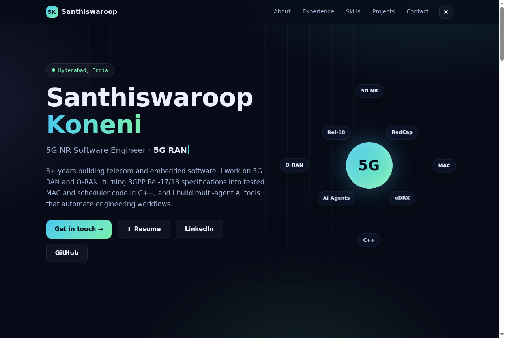

# Santhiswaroop Koneni - Portfolio

Personal portfolio of a 5G NR Software Engineer: Layer 2 MAC and scheduler, C++, embedded systems and AI agents.

**Live site:** https://konenisanthiswaroop.github.io

## Pages

- [Home](https://konenisanthiswaroop.github.io): about, experience, skills, projects, education, contact
- [3GPP Explained](https://konenisanthiswaroop.github.io/notes.html): RedCap, eRedCap and eDRX in plain language

## About this site

A single-page static site in plain HTML, CSS and JavaScript, with no frameworks or build step. It has a light/dark theme, responsive layout and print-friendly styles. Hosted on GitHub Pages.

Personal project. Contains no employer code or data.
